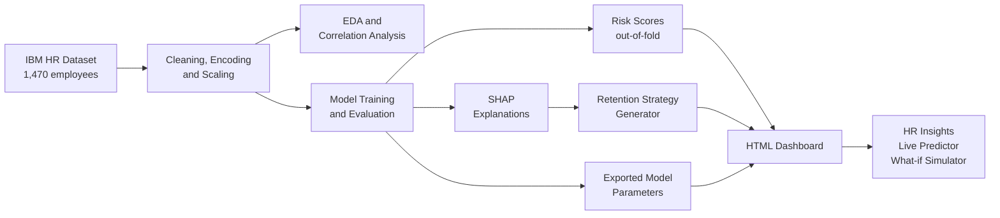

<div align="center">

# Employee Attrition Risk Analyzer

### An explainable AI decision-support system for HR

Predicts **who** may leave, explains **why**, and recommends **what HR can do about it**.


**[Live Demo](https://yash-verse09.github.io/employee-attrition-risk-analyzer/)**  


</div>

---

## Table of Contents

- [Overview](#overview)
- [Why this project is different](#why-this-project-is-different)
- [Key features](#key-features)
- [Screenshots](#screenshots)
- [System architecture](#system-architecture)
- [Dataset](#dataset)
- [Methodology](#methodology)
- [Results](#results)
- [Tech stack](#tech-stack)
- [Project structure](#project-structure)
- [Getting started](#getting-started)
- [Limitations](#limitations)
- [Future scope](#future-scope)
- [Author](#author)

---

## Overview

HR teams usually learn about attrition **after** an employee has left, together with the hiring, training and experience cost that follows. Most prediction projects stop at a Yes/No answer, which tells HR nothing about what to change.

This project turns a prediction into a decision. Every employee gets a risk score from 0 to 100, the main reasons behind it, and a recommended HR action. The whole system runs in a single HTML dashboard that needs no server.

---

## Why this project is different

| Typical attrition project | This project |
|---|---|
| Predicts Yes or No | Gives a 0-100 risk score with Low, Medium and High levels |
| Reports accuracy | Judges models on recall, F1 and ROC-AUC, because the data is imbalanced |
| No explanation | Explains every prediction with SHAP |
| All reasons treated equally | Separates reasons HR **can** change from those it **cannot** |
| Stops at the model | Generates department-wise retention strategy and cost impact |
| Ignores bias | Audits fairness by age and gender and reports the gaps |
| Static notebook | Interactive dashboard with a live predictor and what-if simulator |

---

## Key features

**Explainable risk scoring.** Each score comes with the top factors pushing it up, split into controllable factors (overtime, travel, satisfaction, promotion gap) and profile factors (age, role, marital status).

**Retention strategy generator.** Each risk factor maps to a concrete HR action, summarised as a playbook for every department.

**Impact and cost view.** Estimates how much risk and replacement cost an intervention could remove.

**Live Predictor.** Enter a new employee's details and get an instant score, reasons and recommended action.

**What-if Simulator.** Change overtime, travel, satisfaction and more for an existing employee, and compare risk before and after. It also ranks the biggest levers for that employee.

**Fairness audit.** Recall and false positive rate by age group and gender, plus a test with sensitive features removed.

---

<details>
<summary><b>All dashboard pages</b></summary>

| # | Page | What it shows |
|---|------|---------------|
| 01 | Overview | Headline numbers and whether the risk score separates leavers from stayers |
| 02 | Attrition Drivers | Attrition by any factor, plus SHAP charts |
| 03 | Risk Explorer | Threshold slider showing the recall and precision trade-off, and a watchlist |
| 04 | Employee Lookup | One employee's score, reasons and action |
| 05 | Retention Strategy | Department-wise factors and recommended actions |
| 06 | Impact and Cost | Estimated effect of interventions and replacement cost |
| 07 | Model and Fairness | Fairness by age and gender, sensitive-feature test, limitations |
| 08 | Live Predictor | Score a new employee |
| 09 | What-if Simulator | Before and after risk for changed attributes |

</details>

---

## System architecture



---

## Dataset

[IBM HR Analytics Employee Attrition and Performance](https://www.kaggle.com/datasets/pavansubhasht/ibm-hr-analytics-attrition-dataset)

| Property | Value |
|---|---|
| Employees | 1,470 |
| Attributes | 35 |
| Target | `Attrition` (Yes or No) |
| Class balance | About 16% left, 84% stayed |

---

## Methodology

1. **Clean** the data and drop constant columns.
2. **Explore** attrition patterns across groups and features.
3. **Encode and scale:** one-hot encoding and standardisation, giving 44 model features.
4. **Split** the data 80:20 with stratification, and apply class weighting for the imbalance.
5. **Compare** Logistic Regression, Random Forest and XGBoost using recall, precision, F1 and ROC-AUC.
6. **Score** every employee with 5-fold out-of-fold predictions, so no one is scored by a model that trained on them.
7. **Explain** predictions with SHAP and generate retention actions.
8. **Export** the model parameters so the dashboard can score employees in the browser.

---

## Results

Held-out test set: 294 employees, of whom 47 left.

| Model | Recall | F1 | ROC-AUC |
|---|:---:|:---:|:---:|
| **Logistic Regression (selected)** | **0.617** | 0.443 | **0.798** |
| Random Forest | 0.255 | 0.329 | 0.787 |
| XGBoost | 0.383 | 0.419 | 0.771 |

**Why Logistic Regression?** It caught the most leavers (29 of 47), had the best ROC-AUC, and is the easiest to explain. Its coefficients also let the dashboard score employees directly in the browser.

**Why not accuracy?** Because 84% of employees stay, a model that predicts "stay" for everyone already scores 84%. Recall and F1 show whether a model actually finds the people who leave.

---

## Tech stack

| Area | Tools |
|---|---|
| Data and ML | Python, Pandas, NumPy, Scikit-learn, XGBoost |
| Explainability | SHAP |
| Visualisation | Matplotlib, Seaborn |
| Development | Jupyter Notebook |
| Dashboard | HTML, CSS, JavaScript (single file, no server) |

---

## Project structure

```
employee-attrition-risk-analyzer/
├── index.html          The dashboard (open this file)
├── notebooks/          Analysis and modelling notebooks, run in order
├── data/               Dataset and generated outputs
├── models/             Saved model files
├── outputs/            Generated tables and charts
├── overview.png ...    Screenshots used in this README
├── requirements.txt
└── README.md
```

---

## Getting started

**Run the dashboard.** Open `index.html` in any modern browser. Nothing needs to be installed.

**Run the notebooks.**

```bash
git clone https://github.com/Yash-Verse09/employee-attrition-risk-analyzer.git
cd employee-attrition-risk-analyzer
pip install pandas numpy scikit-learn xgboost shap matplotlib seaborn jupyter
jupyter notebook
```

Then run the notebooks in the order they are numbered.

---

## Future scope

- Connect to a real HR database and retrain as new outcomes arrive.
- Automated alerts for employees who cross the High-risk threshold.
- Validate on larger real-world datasets.

---

## Author

**Yash Gupta**
BCA Semester 5, Department of Computer Applications, ITM University Gwalior

<div align="center">

If you found this project useful, consider giving it a star.

</div>
